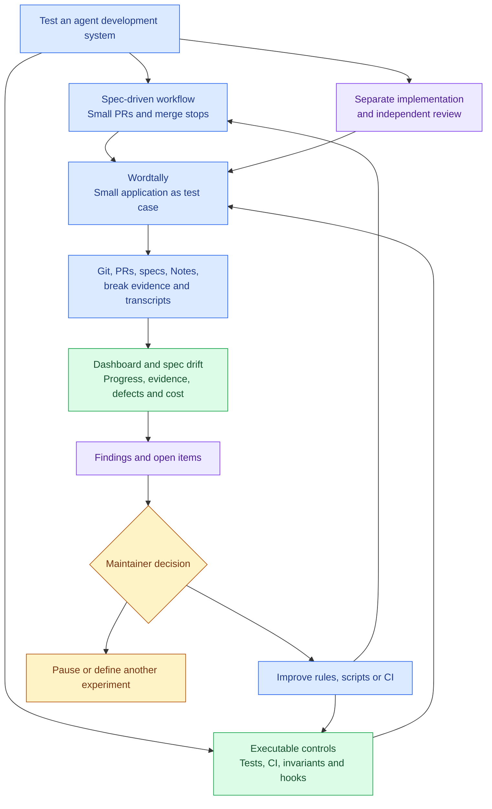
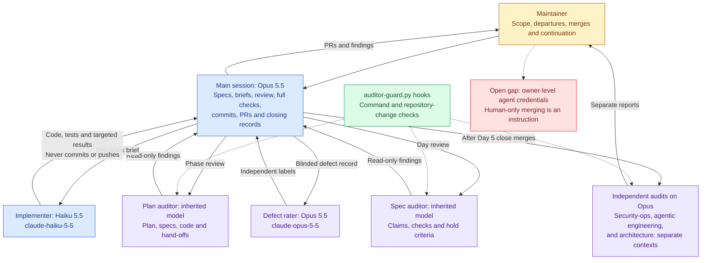
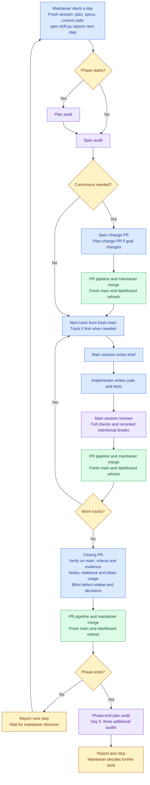
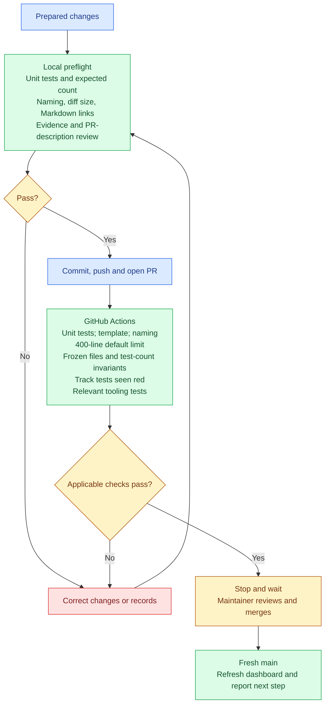
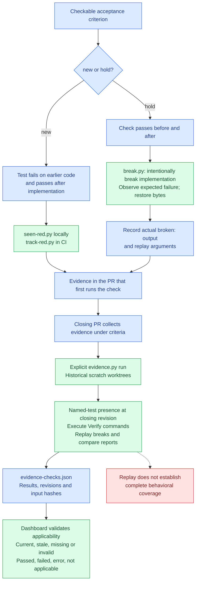
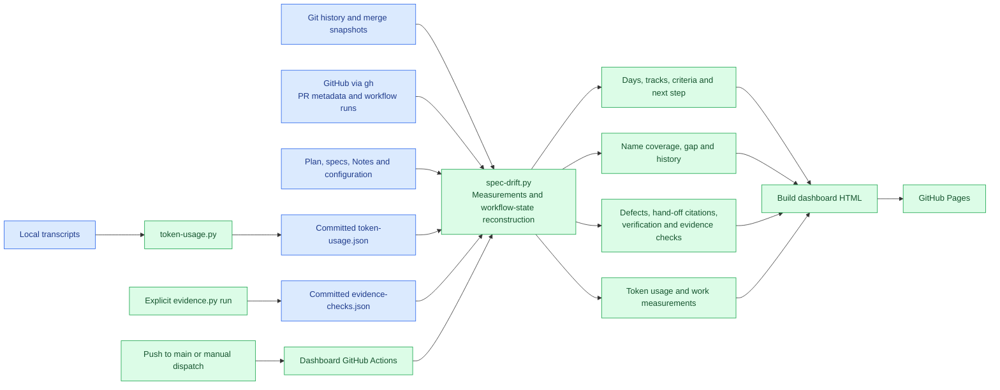
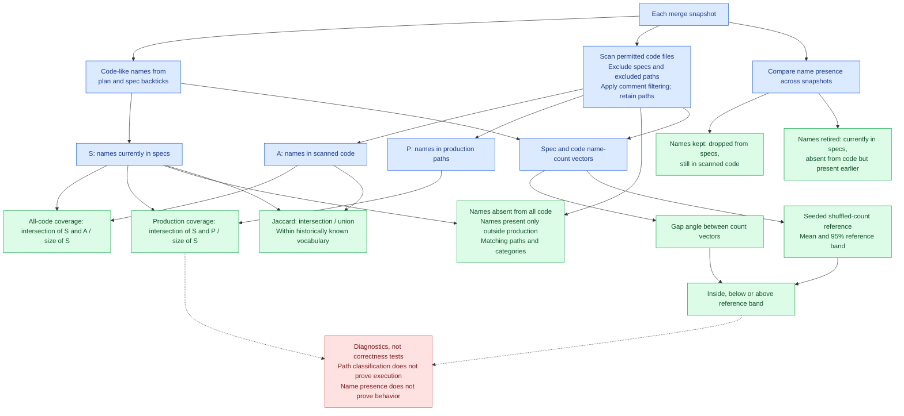
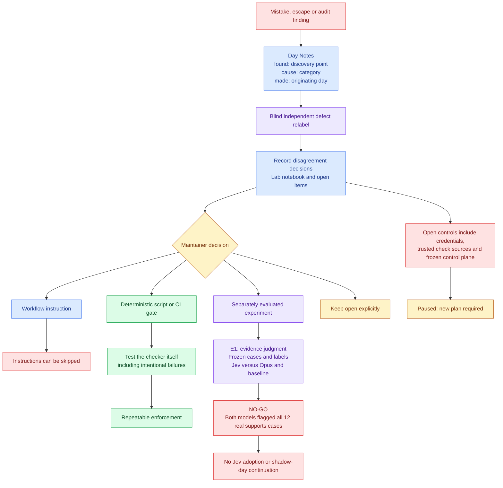

# Wordtally: an agent workflow experiment

Wordtally is a small Python word counter used to test a larger system: spec-driven development
with AI agents, independent audits, human-controlled PRs, executable evidence, and a dashboard
that measures the work. It is a pilot of the
[agentic workflow kit](https://github.com/Yusuprozimemet/agentic-workflow-kit).

The product is the test case. The workflow, its controls, and what they reveal are the experiment.

## Status and navigation

Paused after Day 5 on 2026-10-28; the product plan is delivered. The final notebook entry is
dated 2026-10-29. Further work requires a new plan and maintainer direction. Jev's E1 experiment
ended in **no-go**; it is not an active workflow agent or CI gate.

- [Working order](CLAUDE.md), [spec rules](specs/README.md), and [workflow guide](docs/workflow.md).
- [Live dashboard](https://yusuprozimemet.github.io/wordtally/).
- [Lab notebook](docs/lab-notebook.md): measurements, experiments, audits, and remaining gaps.
- [Product plan](plan.md), [workflow experiment plan](docs/workflow-improvement-plan.md), and
  [spec-drift improvement plan](docs/spec-drift-improvement.md). Plans describe proposals;
  the implementation and notebook establish what actually landed.

Blue means work or artifacts; purple means agents or review; green means automation or
measurement; amber means human decisions; red means failures or limitations.

## 1. The experiment as a whole



## 2. Agents, models, and authority

The main session is documented as Opus 5.5. Plan and spec auditors inherit their session model;
their definitions do not pin one. The implementer and defect rater have explicit model IDs.



## 3. The development loop

Every PR uses the validation pipeline below. Tracks run sequentially from fresh `main`, following
`CLAUDE.md`; `specs/README.md` still contains a conflicting parallel-tracks sentence. The actual
phase order was Days **1, 3**, stop, then Days **2, 4, 5**, stop.



## 4. Local checks, CI, and human merge

CI passing does not authorize the agent to merge. Frozen word-rule tests cannot be edited as a
routine fix; an unmet criterion or required frozen-test change needs a recorded departure and
maintainer decision. There is no repository `/close-day` skill or single preflight script.



The size gate allows an explicit `Oversized:` reason. Service-wiring validation applies when
services exist. Tooling tests are selected by the files changed.

## 5. Evidence creation and historical replay

A passing test, a reproduced break, and evidence that covers every promise are different claims.
Closing PRs collect prior evidence; they should not first demonstrate that a criterion can fail.



Intentional breaks never merge. CI tests the checker; dashboard builds read its committed report
without replaying historical commands. A missing or stale report is not a current pass.

## 6. Dashboard data flow

The dashboard reports the workflow; it does not decide merges or override the sources of truth:
`plan.md` for goals, merged specs for promises, and code on `main` for actual behavior.



## 7. What spec drift measures

Measurements use extracted names, not semantic understanding. Historical snapshots only use
names known at that point, so later specs do not move earlier measurements.



## 8. How the workflow learns



## Findings

- Every day's estimate held (3 pull requests each), and frozen word-rule tests were never edited.
- A lesson written only in Notes did not reach the next day: the same gap recurred on Days 4
  and 5. Behavior changed where a lesson became a rule or script.
- Seen-red evidence was skipped twice before a CI gate enforced it.
- Measurement tools need their own checks: spec evidence once counted as implementation;
  auditor hooks behaved differently across Claude Code clients.
- Human-only merging remains an instruction while the agent has the owner's admin credentials.
  The notebook records the remaining controls to address before more autonomy.

## Run the test application and checks

Wordtally uses Python 3.10+ and the standard library. It counts lines, words, and characters;
supports files or standard input; and adds top words, a built-in stopword filter, and JSON output.
A word is a run of ASCII letters, digits, and apostrophes. Stopwords affect only the top list.

```bash
python -m wordtally --help
python -m wordtally --top 3 example.txt
python -m unittest discover -s tests -t .
```

The measurement tools additionally need `numpy`, `gh` authenticated to GitHub, and Node for page
tests. Run the relevant tooling checks when changing the measurement system:

```bash
python scripts/test_spec_drift.py
python scripts/test_evidence.py
python scripts/spec-drift.py --out spec-drift.json
```
