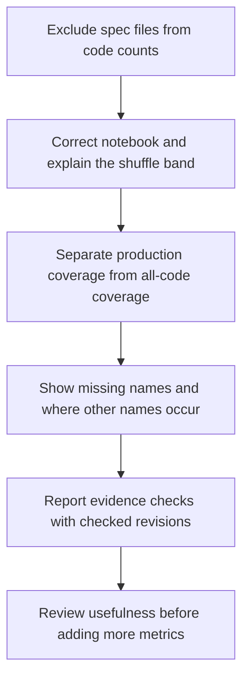

# Spec-drift improvement plan

Written 2026-10-29. Proposal for deterministic dashboard improvements; this document does not
change a gate, start an experiment, or resume the paused feature plan.

## Decision

First, fix the code corpus: spec evidence files must not count as implementation. Correct the
notebook's claim that every gap is null. Then show whether spec names occur in production files
or only in supporting code, and expose evidence-checker results with the revisions checked.
Keep each observation inspectable: a numerator, a denominator, and the names or checks behind it.

Success means a reader can answer three questions without reading the measurement script:

1. Does a vocabulary change come from scanned code, without counting the spec's own evidence?
2. Which spec names are absent from production, and where do they occur instead?
3. Which recorded evidence was actually checked, at which commit, and what failed or remains unchecked?

There is no combined drift score. Vocabulary presence, executable evidence and implementation
correctness are different observations.

## Starting point

- [spec-drift.py](../scripts/spec-drift.py) already computes coverage, Jaccard, names kept,
  names retired and a seeded shuffle baseline. Coverage includes tests and tooling; the
  script explicitly lists that limitation.
- The scanner also includes non-Markdown files under `specs/`, including break manifests.
  Names copied into those JSON records can improve the gap without an implementation change.
- Its `work_kind()` classifier already distinguishes production, tests and tooling for churn.
  Its name scanner currently discards filenames, so production coverage needs path-aware counts.
- The dashboard already shows evidence presence and named-test state. A recorded `broken:`
  line is not the same as a successfully replayed break.
- [evidence.py](../scripts/evidence.py) already checks named tests at closing merge commits,
  runs Verify commands and replays recorded breaks. It currently returns Boolean/text results
  and console output, rather than a dashboard report. It reads the supplied spec and break
  manifests from the working tree while executing against historical code.
- The repository's service configuration is empty. The four-service examples belong to the
  reusable kit's source project, not Wordtally's architecture.
- [E1 returned no-go](lab-notebook.md#e1-a-decision-model-as-an-evidence-checker).
  Jev and Opus each flagged all 12 supported cases. The planned Jev dashboard, shadow days
  and adoption stopped. This proposal does not reopen them.

## Step 0: correct the code corpus and historical account

### Reproduced observations

On the inspected history through PR #33, a fresh call to `trajectory()` using git history
without GitHub PR metadata produced 34 rows. Only row 0 had a null `gap_full`. All 23 rows
for PRs #1 through #23 were inside their shuffled-count reference bands.

| Merge | Current gap | Current shuffle band | Gap with `specs/` excluded |
|---|---|---|---|
| #19, Day 5 close | 46.89 degrees | 35.30-51.04 degrees | 46.89 degrees |
| #24 | 36.20 degrees | 35.63-51.42 degrees | 36.20 degrees |
| #25 | 21.02 degrees | 35.69-50.92 degrees | 36.20 degrees |

The exclusion was tested in memory, without changing the scanner on disk. At #25, the corrected
band is 35.63-51.42 degrees, so the gap returns inside it. This reproduces the contamination
from spec evidence and removes the apparent improvement beyond the band at that merge.
It does not establish that all tooling effects are removed: tests and scripts remain in the
all-code corpus. Historical checkouts and the published page were not independently checked
in this reproduction; it does not establish what the original auditors ran.

### Changes

- Exclude the entire `specs/` directory from `code_counts()`, regardless of file extension.
  Keep it as an input to the spec vector. Preserve the remaining exclusions and name rules.
- Recompute affected historical metrics and invalidate incompatible cached counts. Keep the
  JSON field names and definitions; explain that historical values changed because their code
  corpus was corrected. The later production split uses this corrected baseline.
- Correct the [Day 5 account](lab-notebook.md#verdicts): replace "the gap metric is null on
  every row" with the observed fact that gaps were populated after the initial row but stayed
  inside the shuffled-count reference band through Day 5. Add a dated correction explaining
  the reproduction, rather than attributing an unverified interpretation to the auditors.
- In the selected merge's gap readout, show "inside the shuffled-count reference band",
  "below the shuffled-count reference band", or "above the shuffled-count reference band".
  Treat the endpoints as inside. With no gap or reference band, show "comparison unavailable".
  These labels describe the comparison; they do not certify correctness or statistical significance.

### Acceptance checks

- Adding or editing JSON evidence under `specs/` cannot change the code count vector. With
  unchanged spec names and scanned code, gap, coverage and Jaccard remain unchanged too.
- A matching name in production code, a test or a script still contributes under the existing
  rules. Adding a name to a Markdown day spec still changes the spec vector as appropriate.
- Warm-cache and cold-cache runs agree after the corpus correction.
- Reproduce the historical comparison above, recording revision, environment and command in
  the PR. Check the notebook wording against that output.
- Page tests cover inside, below, above, endpoints and unavailable comparisons.

## Step 1: production name coverage

### Definitions

At merge `m`, use the existing vocabulary extraction and historical visibility rules:

- `S`: distinct names currently extracted from `plan.md` and day specs at that merge.
- `A`: names found in the corrected code corpus from Step 0, with its exclusions and comment handling.
- `P`: names found in files in that corpus for which `work_kind(path) == "prod"`.
- `T`: names found in files in that corpus classified as `test`.
- `G`: names found in files in that corpus classified as `tooling`.

The corrected corpus remains authoritative for all-code coverage. Do not silently expand it
when adding classifications. Production means the classifier's path category, not proof that
a file executes in the product. For Wordtally, verify explicitly that `wordtally/` is production,
`tests/` is tests, and `scripts/` is tooling; document the classifier's fallback for other paths.

| Reading | Definition | Display |
|---|---|---|
| All-code name coverage | `|S intersect A| / |S|` | Existing figure, labelled with its scope |
| Production name coverage | `|S intersect P| / |S|` | New figure beside all-code coverage |
| Present only outside production | `S intersect (A minus P)` | Count and expandable name list |
| Absent from all scanned code | `S minus A` | Count and expandable name list |

Each rate displays its integer numerator and denominator. If `S` is empty, display
"not measured: no extracted spec names", using `null` in JSON. Do not render it as 0% or 100%.
The name lists are sorted and deduplicated. For names found only outside production, show
test/tooling/other categories and matching paths at the selected merge; categories may overlap.
Keep an `other` category so the diagnostic accounts for every name in the corrected corpus.

These readings cover all extracted spec names, including names of tests and tools. A name
absent from production is a diagnostic, not a defect: some names belong only in tests.

### Implementation

Change the scanner to retain paths while counting names. Preserve Step 0's all-code count
vector exactly, and derive the production vector from the same matches. Cache both vectors
by immutable revision and invalidate incompatible cache entries. Continue masking names that
were not yet known at each merge; future specs must not change earlier points.

Add fields alongside `name_coverage`; do not rename or reinterpret existing fields. Compute
the selected merge's diagnostic paths on demand, or cache them separately if necessary, rather
than copying every matching line into every history row. If JSON lists are capped, include the
total, shown count and an explicit truncation marker.

Do not change name extraction, gap, Jaccard, retirement semantics or shuffle calculations in
this step. Small names and names written only in prose remain outside the current extraction.

### Acceptance checks

Use the existing temporary-repository tests in `scripts/test_spec_drift.py`:

- A name occurring only in a test raises all-code coverage but not production coverage.
- A name occurring only in a script behaves the same way and is attributed to tooling.
- Adding the production occurrence raises production coverage and removes it from the
  outside-production list; removing it reverses that change.
- A name occurring in both tests and tooling appears once in the list, with both categories.
- Comment-only occurrences, excluded files, an empty vocabulary and a later-introduced spec
  name retain the established scanner and historical behavior.
- Step 0's corrected all-code metrics are identical before and after the path-aware scanner change on a fixed
  fixture. Warm-cache and cold-cache output agree for the new fields too.
- The page shows both rates, their counts and the diagnostic lists for the selected merge.

## Step 2: report executed evidence checks

### Produce a structured report

Extend `scripts/evidence.py` with an optional `--json PATH` output, preserving its console
interface and failure exit status. Build the JSON from structured check results, not by parsing
the printed messages. Keep existing check behavior unless an explicit missing-input case below
requires a correction.

Report provenance must include the schema version, runner revision and dirty state, Python
version and platform, generation time, requested ref and resolved SHA. For each day, record
the closing merge SHA, Verify base SHA, and the spec and break-manifest paths and hashes.
For a break with an `at` override, record its actual execution SHA separately.

The report describes the inputs supplied to that run. Record the input revision when clean;
mark working-tree inputs explicitly when edited. Do not label a run as checking the original
closing spec merely because it executed against the closing code.

Each check has a stable identity, kind, criterion ID where applicable, execution SHA where
applicable, status and diagnostic. Use these statuses:

| Status | Meaning |
|---|---|
| `passed` | The check ran and met its stated expectation |
| `failed` | A required input was missing or the observed result disagreed with the expectation |
| `error` | The checker could not complete the observation, such as a runner setup failure |
| `not_applicable` | An explicit, supported exception, with its recorded reason |

Absence of a report is "not checked" in the dashboard, never a passed check. Both `failed`
and `error` keep the CLI's nonzero outcome. A spec with no closing merge cannot receive a pass.

Make missing evidence visible rather than allowing an empty loop to imply success:

- A ticked criterion with no recognized named test gets an explicit failed presence check.
- A missing or empty required Verify block gets an explicit failed presence check.
- A required break with no recorded arguments gets an explicit failed check.
- A required but absent `broken:` line gets an explicit failed presence check. An explicit
  `broken: none` remains distinguishable and carries its reason as `not_applicable`.

Do not apply format requirements retroactively to records that predate them. Preserve the
dashboard's existing pre-format distinction and record why a requirement is not applicable.
Verify results belong to the day: do not count a shared Verify command once per criterion.

### Display reports without replaying them during page builds

Use an optional committed artifact at `docs/dashboard/evidence-checks.json`, generated by an
explicit evidence-checker run. The dashboard build reads this artifact; it does not execute
spec commands or mutations. CI continues to test the checker without acquiring an implicit
historical replay step.

Validate the report's schema and input hashes before presenting results as applicable. Compare
the close SHA and input hashes with the selected snapshot's inputs. A mismatch shows the last
checked revision as historical/stale, not as a current pass. Missing reports show "not checked";
invalid reports show "report unavailable" with a diagnostic. Neither disables existing panels.

Keep separate rows or columns for named-test checks, Verify commands and replayed breaks.
Show passed, failed, error and not-applicable counts, plus unreported required checks. Any rate
uses `passed / (passed + failed + error)` for that check kind, with not-applicable and unreported
counts alongside it. With no executed or failed checks, show no rate. Do not pool these kinds
into an evidence-completeness percentage.

The existing "Seen red" presence reading stays labelled as recorded evidence. The new replay
reading says whether the recorded break reproduced its expected report. Neither claims that
the break exercises every promise in the criterion, or that today's code still satisfies it.

### Acceptance checks

- In `scripts/test_evidence.py`, cover a successful replay, a report mismatch, missing break
  arguments, missing named tests, missing Verify, an explicit exception and a runner error.
- A run with zero recognized tests or commands cannot produce a misleading all-passed report.
- JSON and console output describe the same checks and preserve the exit-code contract.
- A break's `at` override, edited input files and the resolved closing SHA appear accurately
  in provenance. A diagnostic failure still leaves a valid report where the runner can write one.
- Dashboard tests cover valid, absent, malformed and stale artifacts, zero denominators and
  safe rendering of report text. A report cannot turn a missing observation into a pass.
- Every pre-existing numerical metric is identical with and without the optional artifact.

## Step 3: make interpretation visible

Put a short limitation beside each affected panel, keeping the full caveat list available:

- Vocabulary: "Matches extracted names, not behavior. Test and tool names may legitimately
  be absent from production."
- Gap: "Compared with seeded shuffles of name counts; this is not a correctness test."
- Evidence: "Checks the recorded evidence against the revisions shown; does not establish
  complete behavioral coverage or current correctness."

Keep the chance baseline and band, with Step 0's descriptive comparison labels. Do not add a
significant/not-significant badge or interpret an inside-band result as proof of no signal. Keep
existing `names_kept` and `names_retired` readings with their exact definitions; neither means
the name was correctly removed. A future transition view must show whether a name disappeared
from spec, code or both before attributing intent.

Do not add empty structural or meaning-drift sections. Existing service panels remain useful
for configured projects, without inventing service boundaries for Wordtally.

## Delivery and validation

Deliver as separately reviewable PRs under the repository's 400-line limit. Split a step
further when needed; each PR should leave a working producer/consumer contract.

1. Exclude `specs/` from code counts, add regression checks, reproduce historical values and
   correct the notebook. Add descriptive shuffle-band labels, splitting the PR if needed.
2. Path-aware scanner, production coverage and focused regression checks.
3. Coverage display, diagnostic name/path lists and local caveats.
4. Structured evidence results, explicit missing-input outcomes and JSON export.
5. Optional report loading, provenance validation and evidence dashboard display.

Run `python scripts/test_spec_drift.py` for scanner or dashboard changes, and
`python scripts/test_evidence.py` for checker changes. Run both when their integration changes.
Use the existing Node-backed page checks, build the single-file dashboard and visually inspect
coverage and evidence panels, including the missing-report case. Run the repository's required
PR checks. Record any unavailable validation rather than claiming it passed.

For Step 0, record the intentional changes to historical all-code figures. For subsequent
scanner changes, compare against that corrected baseline at a fixed revision and require
unchanged existing figures. Inspect real diagnostic names
and measure cold/warm build time and JSON size. Record those observations in the PR. Do not
commit incidental generated dashboard output or cache files as part of the implementation.

Stop after these five deliveries and assess whether the views expose actionable gaps.
No feature days or model calls are needed to complete them.

## Deferred decisions

- **Importance weights:** defer until an observed use case justifies the subjective weights.
- **Structural drift scores:** movement alone does not establish a broken promise. First
  identify a concrete stale-reference or boundary question that the current checks cannot answer.
- **Hand-off completion:** keep citation tracking distinct from verified resolution.
- **Embeddings or decision models:** require a new, separately approved experiment with frozen
  labels, an error policy and a false-alarm bar. E1's no-go remains in effect.
- **Mutation survivors:** candidates for review, including equivalent behavior. A survivor
  established to violate a criterion demonstrates a test gap; it does not by itself establish
  that behavior drifted after the criterion was originally satisfied.

These are later decisions, not dependencies or automatic follow-on work.
